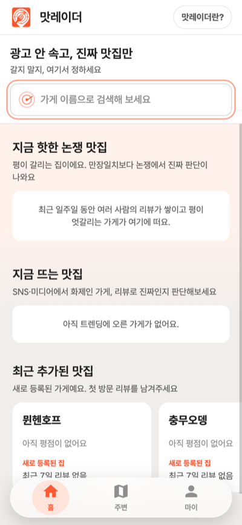
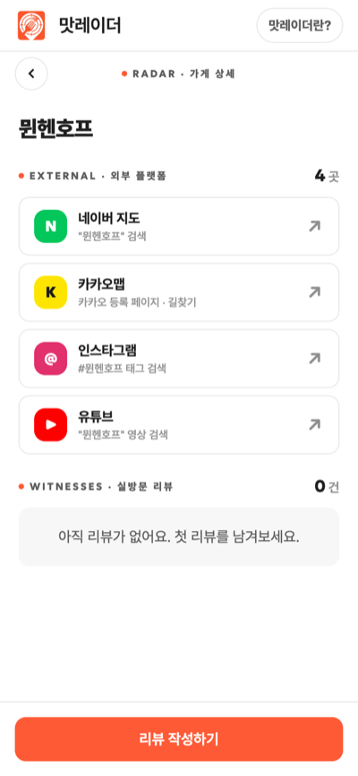
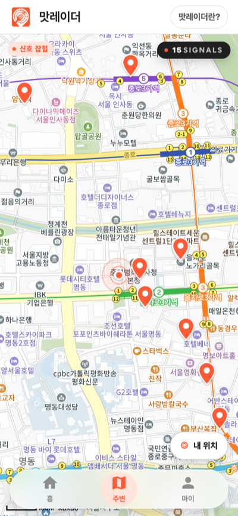

## 🐤 Studying Backend Developer 🐤   
### ✏️ Currently focused on Spring & Java ✨

---

### 🍽️ Project — 맛레이더 (MatRadar)

> 광고·체험단 리뷰에 속지 않고 **진짜 맛집을 판단하게 돕는** 신뢰 기반 맛집 서비스 — 한국형 타베로그

**1인 개발** · 2026.05 ~ 2026.11 (약 7개월) · 2026.11 운영 시작 후 계속 개선 중

| 첫 방문 소개 | 홈 | 가게 상세 | 주변 지도 |
|:---:|:---:|:---:|:---:|
|  |  |  |  |

- **맛집 DB 가 아니라 "논쟁 DB"** — 홈 첫 섹션은 추천 목록이 아니라 지금 평이 엇갈리는 가게
- **별점 인플레이션 방지** — 리뷰는 3점에서 시작하고, 4~5점을 고르면 바로 경고. 별 색도 1점 회색 → 5점 무지개로 달라진다
- **믿을 수 있는 평점** — 작성자 신뢰도를 반영한 가중 평균, 한 사람은 가게당 최신 리뷰 1건만 반영
- **네이버·카카오 위에 올라타기** — 외부 링크로 이어 주고, 서비스는 판단에 집중

**만들면서 내린 판단**
1. **탐지는 판정이 아니라 우선순위로** — 오탐 비용이 비대칭이라 자동 제재를 두지 않고, 평점은 삭제 대신 가중으로 희석
2. **"성공" 메시지를 믿지 않고 결과를 확인** — 업로드 없이 성공한 백업, IPv6 /64 로 우회되던 IP 제한, 옛 버전이 돌던 "배포 완료"
3. **사진 처리 동시성을 건수가 아니라 메모리로** — 측정한 픽셀당 바이트로 예산을 잡은 공정 세마포어

  
  
  
  
  
  
  

  
  
  
  
  
  
  

---
  
  
### 📝 main studying 📝  

  
  
  
  
  

### ✨ interested ✨

  
  
  
  

### 📚 studied 📚

  
  
  
  

<!--
---

<!--

-->

---
## 🗊Study Memo Notion (Korean)

---

### 👍 Thanks for Watching 👍

<!---->
